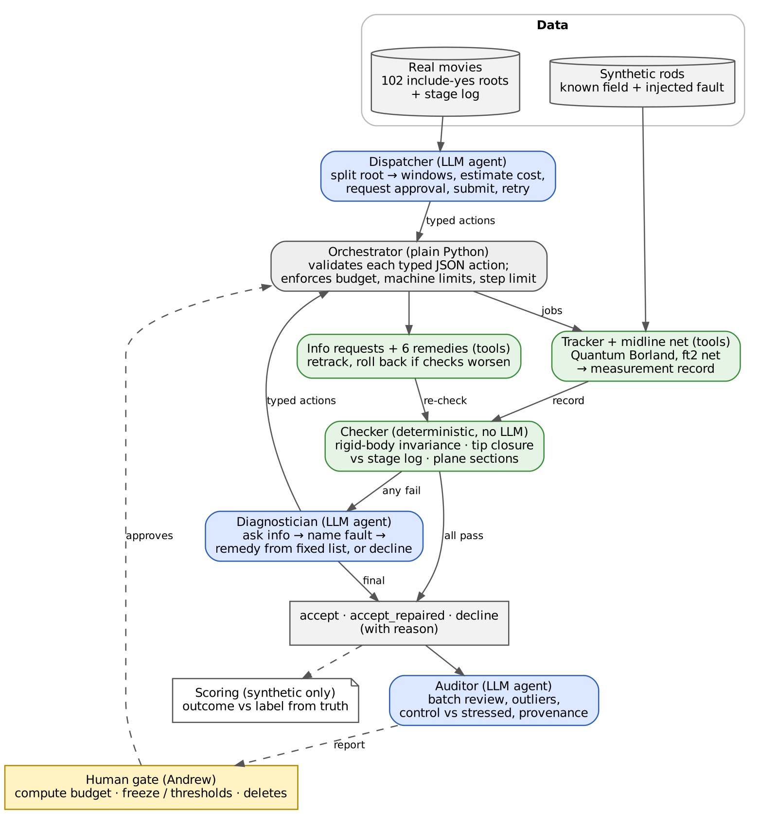

# AM/ME/CE 295 · Lab Report 2

**Name:** Andrew Oldag (solo project)  
**Repository:** https://github.com/AndrewOldag/oldag_andrew_me295_project_repo  
**Covers:** 15 Oct – 1 Nov 2026. Written from the running log (`docs/running_log.md`), `docs/decisions.md` and the results READMEs. Commit hashes refer to `main`.

---

## A. Project description and goal

### A1. Problem statement and goal
A growing plant root is a slender rod whose material generates its own strain: the axial strain rate sets elongation, and its difference across the section sets the rate of bending. This strain-rate field is measured by image correlation on time-lapse movies, and the measurement can fail silently (stage drift, texture loss, a second root in frame, midline errors). Today each profile is checked by eye, which does not scale to the 102 usable roots (24 h each) of a drought and recovery experiment. The project asks whether an LLM agent, guided by deterministic beam-kinematics checks, can decide when a measurement can be reported, repaired or must be declined, more reliably than a fixed script, a rule-based remedy tree and a single agent without the checks. Scope is kinematics only: no stress, stiffness or constitutive law.

### A2. Related work
**Domain.**

- KymoRod (Bastien et al. 2016), PatchTrack (Henry, Miller & Spalding 2023), Chavarría-Krauser et al. 2008 and Krupař et al. 2026 each return a velocity or strain-rate profile. Whether to trust a profile is decided by a person after the run.
- Quality control is manual: Youssef et al. 2018 checked profiles by eye; Platre et al. 2024 report 8–25 % of roots lost, with no automatic test of a measurement.
- The checks used here come from the kinematic relations in this literature: the flank strain-rate difference is tied to the material curvature rate for a rod of constant width (Silk & Erickson 1978; Chavarría-Krauser 2006; Bastien et al. 2014).

**Agent systems.**

- Yao et al. 2023, ReAct: reason–act–observe over typed calls; 47 % of ReAct failures were reasoning errors including repetitive loops (Table 2). Here: the same loop over a fixed action space with a step limit.
- Geifman & El-Yaniv 2017, selective classification: a reject option, with selective risk against coverage. Here: decline is the reject option, false accepts are the selective risk.
- Wei et al. 2025, agentic science survey: provenance of tool versions and parameters is required. Here: every run records the freeze tag, commit, model and Claude Code version.

**Gap.** The tracker stays fixed. This project adds the layer around it: deterministic checks that any correct rod measurement must satisfy, an agent that names the fault and repairs or declines, and scoring against known truth.

[ANDREW: mark which of these papers you read yourself and which were found or summarised by an agent; the debrief asks for the split.]

## B. Why an agent

### B1. Why not a fixed script, an optimizer or a single prompt
- **The decision.** When a check fails, something must name the fault behind it, choose a remedy from a fixed list, judge whether the remedy worked, or decline to report. The cause is not given by the check: a closure failure can come from a bad stage correction, rigid drift, midline jitter or a second root. The evidence is spread over several information requests (stage-log residuals, velocity profile, frame quality).
- **Cover-up test.** Loading frames, tracking, computing the three checks and applying a remedy are plain tools (green in Fig. 1). The fault diagnosis and the repair-or-decline call are the agent's decision (blue).
- **A fixed script** reports every measurement. On the scored set it accepts all 18 decline rods (balanced accuracy 0.67).
- **A rule tree** encodes the diagnosis in advance. It is the main baseline (D2). It is strong on the faults it was written for and has no way to handle a fault it was not written for.
- **No optimizer applies.** There is no continuous objective. The output is a categorical judgement with a reason.
- **A single prompt without the checker** is the single-agent baseline. It scores well below the diagnostician (D2).

## C. Agent design

### C1. Design

*Fig. 1. Blue: LLM agents. Green: deterministic tools. Grey: plain-Python orchestrator. Yellow: human approval. Every agent step is one typed JSON action; the orchestrator validates it against a schema and executes it. Agents never touch files, hosts or the queue directly.*

- **State:**
  - A measurement record per root-by-window task: the field, check values, remedies tried and roll-backs.
  - Run traces with every prompt, action, result and token count.
  - A task board (`tasks/`).
- **Memory:** none across tasks. Each diagnostician call sees one task.
- **Stopping conditions:**
  - Step limits: dispatcher 4, diagnostician 8, single agent 8, auditor 20 per batch.
  - The diagnostician stops when it emits `finish` with an outcome.
  - A remedy that worsens the checks is rolled back.
- **Human approval:** compute budgets before any cluster job, every threshold or freeze change, and any delete.
- **Pins:** model `claude-opus-5-5`, Claude Code 2.1.310 (`config/models.yaml`). The launcher refuses any other version.

### C2. Why each part is there, and what breaks without it

| Part | Type | What breaks if removed | Evidence |
| :-- | :-- | :-- | :-- |
| Checker | Tool | The agent must judge from raw info alone. The single agent without it: balanced accuracy 0.63 vs 0.93, decline-class accuracy 0.10 vs 0.79, and 66 of 153 runs end at the step limit | Freeze v4 |
| Diagnostician | Agent | Failed checks map to fixed rules (remedy tree) or nothing (script). The tree ties on balanced accuracy but makes 2 false accepts; the script makes 18 | Freeze v4 |
| Fixed remedy list and roll-back | Tool | The agent could invent settings; a remedy that breaks a clean rod would be kept. Two remedies were fixed and one setting was withdrawn after they failed clean rods | LR1 |
| Orchestrator and typed actions | Tool | No schema validation, budget or machine-limit enforcement | 0 harness errors in 306 v3 LLM runs |
| Dispatcher | Agent | Its job is mostly scriptable (cover-up test). Its own decisions are retries and ordering under a budget. It is not yet measured against its fixed-script baseline | Open, see E2 |
| Auditor | Agent | Batch-level errors pass. On real batch 1 it was the only stage that flagged 4 windows whose closure could not be computed; the rule now declines them | Real batch 1 |

### C3. Current working system (demo)
- **Offline tests:** `python -m pytest -q tests` gives 324 passed, 3 skipped, 50 s, at `f04a286`. This uses no agent call and no tracker. It covers rods against analytic truth, checker pass and fail, remedies and roll-back, metrics, baselines, the dispatcher on a fake queue, the auditor, the board and the pre-push check.
- **End to end on real movies:** `python scripts/real_slice.py --windows <ROOT:A-B ...> --config <private host config>` runs dispatcher → tracker → checker → diagnostician → auditor.
  - 16-root subset: 48 windows, 3 runs. In every run, 43 accepted, 5 declined (all at closure), auditor flagged 2. Outcome and auditor decision were unanimous on 48 of 48 windows; the fault named was unanimous on 3 of the 5 declines.
  - First real batch: 11 roots, 126 windows, one per experiment and condition. 114 accepted, 9 declined, 3 tracker errors. Registration was kept on 1 window and rolled back on 4.
- **Checker only, no agents (batch 2):** 437 of 1,063 windows were run before the lab server went offline. 420 measured, 371 accepted, 49 declined, 17 tracker failures.

## D. Evaluation

### D1. Checks that do not rely on the LLM
- **Synthetic rods with a known field.** Each rod is labelled accept_clean, accept_repaired or decline by a tracker-only sweep before any method runs: the measured field against truth, within a set tolerance, with and without each remedy.
- **Success is outcome against label:**
  - Balanced accuracy over the three classes.
  - False accepts (reporting a bad measurement): the main safety metric. The target is 0.
  - Abstention precision and recall, so that declining everything cannot score well. Decline-all scores 0.33 balanced accuracy.
  - Agreement over 3 repeats (unanimity and Fleiss $\kappa$).
- **Held-out separation.** Scored seeds were never seen by any prompt or threshold work. Prompts, thresholds and remedies are frozen and tagged before scoring (`freeze-v3`, `freeze-v4`).
- **Checker thresholds come from the math or measured noise, not by eye:**
  - Synthetic closure 1.0 px/h.
  - Real-movie closure 19 px/h: the 95th percentile over 41 control windows from 16 roots (median 3.6 px/h).
- **Is the synthetic data itself right?** (Lab report 1 feedback)
  - Field-level rods match the analytic strain rate within 0.08 %/h.
  - A read-only audit against the literature moved the rods to real-movie scale (2.105 µm/px) and to reported bend rates (16–30 °/h).
  - The scoring found two labelling problems, both kept on the record:
    - In v3 every accept_repaired rod measures well without its remedy.
    - The second_root decline label conflicts with the width-free remedy, which leaves a good centre profile.
  - A sizing round (freeze v3.1) looked for faults that both degrade the field and are repaired on 3 of 3 seeds. It found none, so it ended at its stop rule.
- **Real movies have no ground truth.** On real windows the evaluation is check values, the noise floor from control roots, agreement across repeats, and the auditor.

### D2. Baselines (same tools, no agent) and current result
Freeze v4 (tag `freeze-v4`; 51 rods on unseen seeds 26–28: accept_clean 18, accept_repaired 9, decline 24). LLM methods run 3 repeats each.

| Method | Balanced accuracy | Decline-class accuracy | False accepts per run set | Unanimity, 3 repeats |
| :-- | :-- | :-- | --: | :-- |
| Fixed script (reports everything) | 0.67 | 0.00 | 18 | – |
| Rule-based remedy tree | 0.93 | 0.79 | 2 | – |
| **Diagnostician** (with checker) | **0.93** (0.92–0.94) | 0.79 | **0** | 46 of 51 ($\kappa$ = 0.887) |
| Single agent (no checker) | 0.63 (0.58–0.69) | 0.10 | 0.3 | 34 of 51 ($\kappa$ = 0.626) |
| Decline-all (reference) | 0.33 | 1.00 | 0 | – |

- The diagnostician matches the remedy tree on accuracy and makes no false accepts (tree: 2). It does not yet beat the tree on accuracy.
- The checker is what makes the agent work: the same model without it falls to 0.63.
- **Cost.** Diagnostician: 153 runs, 655 steps, 3.06 M input and 0.39 M output tokens, 4,560 s of call time. Single agent: 153 runs, 1,040 steps, 4.79 M in, 0.64 M out, 7,539 s.
- **Temperature.** The Claude Code CLI exposes no temperature setting, so run-to-run spread is measured with repeats instead.
- **Earlier freeze v3** (same design, seeds 20–22): diagnostician 0.69, 0 false accepts. Its misses were declines of repairable rods. Three fixes (C1–C3) were approved and scored on new seeds as v4. v3 results stay as scored.

## E. Plan and risks

### E1. Plan
| By | What works |
| :-- | :-- |
| Lab report 3, 15 Nov | All 102 include-yes roots through the checker (batch 2 resumes when the lab server is back). Agents over every window with a failing or not-computable check. Dispatcher measured against its fixed-script baseline on a fake queue with injected job failures (time to finish, retries, budget overruns). The real slice runs from one README command |
| Lab report 4, 29 Nov | Integrated run over all roots with 2 repeats on the 16-root subset. Failure modes listed for synthetic and real windows. Auditor evaluated on planted batch errors (catches, false alarms) |
| Presentation, 2 Dec; final, 9 Dec | 4-page paper with reliability evidence, AI Use Declaration, clean-clone reproduction |

### E2. Biggest risk and question for the TAs
- **Risk:** the synthetic set cannot show repair skill. Every repairable rod also measures well without its remedy, so accept versus decline carries the claim. On real windows, closure at 19 px/h catches only gross failures, and the other two checks are too noisy to gate.
- **Question:**
  - Is a result framed as "the agent matches a hand-written rule tree on accuracy with zero false accepts, and the checker is what makes it work" enough for the course's agent-versus-baseline requirement?
  - Or should the remaining weeks go to a harder held-out fault set where a fixed rule tree must fail?
- **Second question:** the dispatcher and auditor pass the cover-up test only in part. Is it acceptable to evaluate them as operator agents (planted failures, false alarms) rather than in the research loop?

---

## Changes since Lab report 1
- **Root count:** 102 include-yes roots (manifest), not 118. The earlier inventory counted every folder.
- **Real movies are in.** In response to Lab report 1 feedback:
  - A real-movie midline net, fine-tuned on 181 traced frames; held-out median distance 2.4 px, 0 of 28 frames off the root.
  - The real closure threshold measured from control windows.
  - A 16-root subset with agents and repeats, and a first full batch with agents.
- **Literature-reviewer agents dropped.** A read-only spec audit replaced them: 71 findings, all marked. Its evaluation findings produced freeze v3:
  - Decline-all had scored 12 of 15 on the old held-out set.
  - Abstention metrics and repeat agreement were not computed.
  - Rods were not at real scale.
- **Compute moved off the lab server.** It is used for storage only. Tracking runs on a lab workstation and on the campus cluster CPU, after equivalence tests (identical renders; tracks within $10^{-6}$ px). Cluster spend about \$4.7 of an approved \$15.
- **Biology values are out of scope.** REGR and growth-zone values are kept off the public repository; only outcomes and check values are published.

## Repository and log
- **Commits:** 699 on `main` at `f04a286`, 557 since Lab report 1 (`4ab1c32`).
- **Running log:** one entry per session in `docs/running_log.md`.
- **Decisions:** dated, with reasons, in `docs/decisions.md`.
- **Results:** every result folder has a README with its command.
- **Workflow:** parallel build sessions work on their own branches and are merged by a coordinator. A task board records owner, state, host and blocker.
- **Pre-push check:** blocks host names, keys, data files and private paths before anything reaches the public repository.

## AI Use Declaration
| Tool | Used for | What was checked by me |
| :-- | :-- | :-- |
| Claude Code (Opus 5.5) on the build VM, parallel sessions | Code, tests, tracker and agent runs, results READMEs, running-log entries | [ANDREW] |
| Claude (Opus 5.5), planning account | Specs and work orders, design review, spec audit design, branch merges, this report's draft and Fig. 1 | [ANDREW] |
| Fresh-session reviewer agents | Independent review and the spec audit (71 findings, each accepted or rejected by me) | Every finding marked by hand |
| `claude-opus-5-5` inside the system | Dispatcher, diagnostician, auditor, single-agent baseline (the system under test) | Scored against labels from tracker-only sweeps |

- **Decisions kept by me:** thresholds, freezes, fault labels, compute budgets and deletes. Each approval is a dated line in `docs/decisions.md`.
- **Midline training frames:** the 181 training traces of the real-movie midline net (72 earlier traces, 109 from a review pack) were traced or corrected by me in a review tool. [ANDREW: confirm wording]
- [ANDREW: one line on what you verified yourself, e.g. numbers spot-checked against result files, the kinematic relations, the threshold derivations.]
