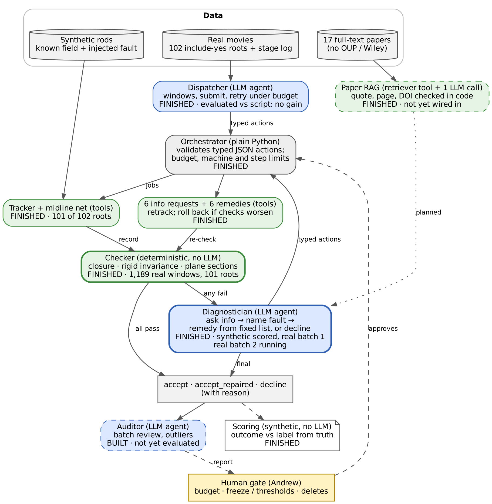

# AM/ME/CE 295 · Lab Report 3

**Name:** Andrew Oldag (solo project)  
**Repository:** https://github.com/AndrewOldag/oldag_andrew_me295_project_repo  
**Demo slides:** https://docs.google.com/presentation/d/1_Us5OFJjE350BA6wntecYVPUhjM90kz8vTeE5Xo2hC4/edit  
**Covers:** 1 – 15 Nov 2026. Written from the running log (`docs/running_log.md`), `docs/decisions.md` and the results READMEs. Commit hashes refer to `main`.

---

## Summary of this period
- **Working loop, real tool output.** The diagnostician agent runs in a loop with the tracker, the checker and the remedy tools. Each step is one typed action; the checker (no LLM) re-checks after every remedy. Run on 51 held-out synthetic rods (3 repeats) and on 126 real windows (batch 1). On the 84 batch-2 windows that fail closure, the remedy tree (same tools, no agent) ran on 38 before connection failures stopped the run; the diagnostician did not run there.
- **Baselines run, not planned.** Diagnostician vs fixed script, rule-based remedy tree and single agent without the checker (synthetic). Dispatcher agent vs fixed script (fake queue, 50 batches). Paper RAG vs keyword search (25 questions, 3 repeats).
- **All 102 include-yes roots through the checker** except one (101 roots, 1,189 windows).
- **Justifying the agents.** The dispatcher showed no scheduling gain over its fixed script; it leaves the research loop (C2). The auditor reviews an LLM's output and is not yet checked; its check is planned (E1).

## A. Project description and goal

### A1. Problem statement and goal
A growing root is a slender rod whose material generates its own strain; the axial strain-rate field sets elongation and its difference across the section sets bending. The field is measured by image correlation on time-lapse movies, and the measurement can fail silently (stage drift, texture loss, a second root, midline errors). The project asks whether an LLM agent, guided by deterministic beam-kinematics checks, can decide when a measurement can be reported, repaired or must be declined, more reliably than a fixed script, a rule-based remedy tree and a single agent without the checks. The target data are 102 roots of a drought and recovery experiment, 24 h each. Scope is kinematics only.

### A2. Related work
Unchanged from Lab report 2 (KymoRod, PatchTrack, Chavarría-Krauser 2008, Krupař 2026 for the measurement; Silk & Erickson 1978, Bastien 2014 for the check relations; ReAct and selective classification for the agent design). Added this period: a retrieval index over 17 of the full-text papers (C3, RAG), built only from papers not published by OUP or Wiley.

## B. Why an agent
- **The decision.** When a check fails, the cause is not given by the check: a closure failure can come from a bad stage correction, rigid drift, midline jitter or a second root. Something must name the fault from evidence spread over several information requests, pick a remedy from a fixed list, judge whether it worked, or decline.
- **Cover-up test.** Tracking, the three checks, the remedies and the roll-back are plain tools. Fault diagnosis and the repair-or-decline call are the agent's decision.
- **What the baselines show (D2).** A fixed script reports every measurement (18 false accepts of 51). A rule tree encodes the diagnosis in advance and ties the agent on accuracy but makes 2 false accepts. A single agent without the checker falls to 0.63.

## C. Agent design

### C1. Design

*Fig. 1. Blue: LLM agents. Green: deterministic tools. Grey: plain-Python orchestrator. Yellow: human approval. Each box states its status. Thick borders: the loop evaluated in this report. Dashed: built but not yet evaluated or not yet connected.*

- **State:** a measurement record per root-by-window task (field, check values, remedies tried, roll-backs); run traces with every prompt, action, result and token count; a task board (`tasks/`).
- **Memory:** none across tasks. Each diagnostician call sees one task.
- **Stopping:** step limits (diagnostician 8, auditor 20 per batch, dispatcher 4); `finish` with an outcome; a remedy that worsens the checks is rolled back.
- **Human approval:** compute budgets, every threshold or freeze change, every delete.
- **Pins:** model `claude-opus-5-5`, Claude Code 2.1.310 (`config/models.yaml`). The launcher refuses any other version.

### C2. Which agents are kept, and why

| Part | Type | Status | What breaks if removed | Evidence |
| :-- | :-- | :-- | :-- | :-- |
| Checker | Tool | Finished | The agent judges from raw info alone: single agent without it 0.63 vs 0.93 balanced accuracy, decline accuracy 0.10 vs 0.79, 66 of 153 runs at the step limit | Freeze v4 |
| Diagnostician | Agent | Finished | Failed checks map to fixed rules (tree: 2 false accepts) or nothing (script: 18) | Freeze v4 |
| Remedies and roll-back | Tool | Finished | The agent could invent settings, and a remedy that breaks a clean rod would be kept | LR1 |
| Orchestrator, typed actions | Tool | Finished | No schema, budget or step-limit enforcement | 0 harness errors in 306 v3 LLM runs |
| Dispatcher | Agent | Finished; **leaves the loop** | Nothing measurable: the fixed script finished as fast or faster in every scenario (D2) | Dispatcher eval |
| Auditor | Agent | Built; not yet evaluated | On real batch 1 it was the only stage that flagged 4 windows with no computable closure (now a rule) and 19 summary outliers that closure does not catch | Real batch 1 |
| Paper RAG | Tool + 1 LLM call | Finished; not connected | Not yet in the loop | RAG eval |

- **Dispatcher decision.** Its job (windows, submit, retry under budget) passed the cover-up test only in part, and the measured comparison found no gain. The fixed script runs the batches from Lab report 4 on; the dispatcher agent stays in the repository as an evaluated option.
- **Merging agents.** The diagnostician and the auditor work from different context (one window vs a whole batch) and different permissions (remedies vs read-only), so they stay separate.
- **Checking the LLM reviewer.** The auditor reviews accepted windows, which an LLM decided. It is not yet checked. Plan (E1): plant known errors into accepted batches and count catches and false alarms. The build itself is reviewed by a second model family (Gemini 4 Argon, read-only): it recomputed every freeze v4 metric with independent code (0 disagreements).

### C3. Current working system (demo)

**The loop, one synthetic rod (freeze v4, `results/2026-10-25_freeze_v4/runs/diagnostician_v3_growth_zone_rigid_drift_z0.5_s26_r0_trace.jsonl`).** Label: accept_repaired (rigid drift).

| Step | Agent action (typed JSON) | Tool result | Agent reasoning (shortened) |
| :-- | :-- | :-- | :-- |
| 0 | – | Checker: closure 8.23 px/h (limit 1.0), fail; rigid invariance, plane sections pass | – |
| 1 | `request_info: stage_log_summary` | Steady residual 0.21 px per frame pair; stage moves every pair | Only closure fails: whole-frame motion |
| 2 | `request_info: velocity_profile` | Tip path 219.1 µm/h vs basal velocity 201.8 µm/h | Uniform translation, not rotation |
| 3 | `apply_remedy: register_frames` (fault rigid_drift) | Retrack; checker: closure 0.31 px/h, all three pass; kept | Registration is the listed remedy |
| 4 | `accept` (confidence 0.85) | Outcome accept_repaired = label | Closure 8.23 → 0.31 confirms the fault |

4 calls, 18.1 k input and 2.5 k output tokens, 28 s of call time. A low-texture rod in the same set ends in `decline` after the agent enlarges the patch to its largest setting and all three checks still fail.

**Real windows.**

- **Batch 1** (11 roots, one per experiment and condition, 126 windows, one run): 110 accepted, 13 declined, 3 tracker errors. Declines: 9 closure failures (fault named: bad stage correction 8, midline jitter 1), 4 not computable (rule). Registration tried on 5, kept on 1, rolled back on 4. 34 diagnostician calls (`results/2026-10-25_full_batch_1_agents/`).
- **Batch 2, checker only** (90 roots, 1,063 windows, cluster): 925 pass, 84 fail closure, 18 not computable, 34 tracker errors, 2 not run. Spend $7.24 of an approved $15 since 23 Oct (`results/2026-10-25_full_batch_2/`).
- **Batch 2, remedy tree** on the 84 windows that fail closure (`results/2026-11-12_batch2_agents/`, merged into `main`). Ran on 38 before the run stopped; the diagnostician was not run on them.

| Method | Run | Accepted after repair | Declined | Error | Not run |
| :-- | --: | --: | --: | --: | --: |
| Fixed script | 84 | 0 | 84 | 0 | 0 |
| Remedy tree | 38 | 9 | 28 | 1 | 46 |

- Kept remedies on the 9: light midline smoothing 5, frame registration 2, larger patch 2. Remedies tried 142: kept 14, rolled back 127.
- 148 retracks as Slurm CPU jobs; median 21 min per window. Spend since 23 Oct: $7.37 at the last ledger read.
- Why it stopped: the cluster connection through the lab server went down twice, one dead connection held a window for about 4 h, and the VM ran low on memory once. The 38 windows are the first in root order, not a sample.

**Commands.**

- `python -m pytest -q tests`: 382 passed, 2 skipped (no agent call, no tracker).
- `python scripts/real_slice.py --out <dir>` runs one real window end to end (README, "Run the real slice").
- `python scripts/dispatcher_eval.py report`, `python scripts/rag.py report`: print the D2 tables from cached runs.

## D. Evaluation

### D1. Checks that do not rely on the LLM
- **Synthetic:** each rod is labelled accept_clean, accept_repaired or decline by a tracker-only sweep against the known field, committed before any method runs. Success: balanced accuracy; false accepts (target 0); abstention precision and recall; agreement over 3 repeats.
- **Real:** no ground truth. The checker gates on closure (19 px/h, the 95th percentile of 41 control windows). "Recovered" means the checker passes after a kept remedy.
- **Dispatcher:** simulated time to finish, windows collected, retries, budget overrun (must be 0), computed by the fake queue.
- **RAG:** the quoted text must occur on the cited page of the cited paper (whitespace and hyphenation normalised) and the DOI must match the corpus list; checked in code, never repaired.

### D2. Baselines (same tools, no agent) and results

**Diagnostician, freeze v4** (51 rods on unseen seeds 26–28; LLM methods 3 repeats).

| Method | Balanced accuracy | Decline-class accuracy | False accepts | Unanimity, 3 repeats |
| :-- | :-- | :-- | --: | :-- |
| Fixed script | 0.67 | 0.00 | 18 | – |
| Remedy tree | 0.93 | 0.79 | 2 | – |
| **Diagnostician** | **0.93** (0.92–0.94) | 0.79 | **0** | 46 of 51 ($\kappa = 0.887$) |
| Single agent, no checker | 0.63 (0.58–0.69) | 0.10 | 0.3 | 34 of 51 ($\kappa = 0.626$) |

**Dispatcher vs fixed script** (fake queue, 102 roots, 1,189 windows; 5 seeds per scenario; median).

| Scenario | Time to finish, script / agent (h) | Collected, script / agent | Retries, script / agent | LLM calls |
| :-- | :-- | :-- | :-- | :-- |
| S0 no failures | 15 / 15 | 1189 / 1189 | 0 / 0 | 42 |
| S1 10 % crash | 16 / 16.5 | 1177 / 1187 | 123 / 136 | 67 |
| S2 25 % crash + preemption | 17.5 / 18 | 1111 / 1168 | 299 / 381 | 73 |
| S3 S1 + 70 % budget | 6 / 6.5 | 1175 / 1188 | 110 / 126 | 47 |
| S4 one persistent-fault root | 15 / 15.5 | 1177 / 1177 | 12 / 24 | 42 |

- No budget overrun in any batch of either method.
- The agent collects more windows in S1–S3 because the engine allowed it 2 retries per window and the script 1 (fixed in the proposal before any run). This is not better scheduling. It is slower by 0.5 h in S1–S4.

**Paper RAG vs keyword search** (17 papers, 693 chunks; 20 answerable and 5 out-of-corpus questions).

| | BM25 (baseline) | Embedding retriever | RAG answers, 3 repeats |
| :-- | :-- | :-- | :-- |
| Gold page in top 1 / top 5 | 11 / 19 of 20 | 8 / 14 of 20 | – |
| Correct (gold page, quote verified) | – | – | 11, 12, 11 of 20 |
| Verified quotes | – | – | 0.85–0.90 |
| Declines on out-of-corpus questions | – | – | 5 of 5, no false declines |

- Keyword search beats the embedding retriever on retrieval. Most RAG misses cite a verified quote on another page of the gold paper; with pages a second reader marked as stating the same fact, 17–18 of 20 are correct (post hoc).

### D3. Failure cases
| Where | Input | Returned | Expected | Likely cause |
| :-- | :-- | :-- | :-- | :-- |
| Diagnostician, synthetic | second_root rods | accept after `use_width_free_ratio`, 8 of 9 | decline | The width-free ratio leaves a good centre profile, so all checks pass after the remedy; the label and the remedy disagree |
| Diagnostician, synthetic | fast_rotation, midline_jitter, displacement_exceeds_patch | 6, 7, 7 of 9 correct | decline | Not analysed per run yet |
| Diagnostician, synthetic | 7 runs with no failing check | remedy applied and kept | no remedy | No rule rolls back a remedy that was not needed |
| Remedy tree, synthetic | second_root; partial_occlusion | 0 and 1 of 3 correct | decline | Not analysed per run yet |
| Dispatcher, fake queue | S4: one root whose jobs always fail | retried every window to the limit (36 jobs vs 24) | name a persistent fault, stop retrying it | No evidence across windows of one root in its view |
| RAG | a01 (Mullen 1998) | quote unverified in 3 of 3 | verified quote | The PDF text has a control character for ± that the model drops |
| Checker, real | 34 batch-2 windows | tracker error, no measurement | measurement or decline | Tracker `arange` error, not yet traced (also stopped one remedy retrack) |
| Remedy tree, real | frame registration on failing windows | closure much worse before roll-back (0708_c6 0-2 h: 19.4 → 20,125 px/h) | closure lower or unchanged | The registration band comes from the window's own strain-rate profile, which is unreliable when the window fails |
| Run infrastructure | batch-2 remedy run | stopped at 38 of 84 windows | 84 windows | Single connection path VM → lab server → cluster; two drops and one silent dead connection. A 30 min channel timeout with reconnect was added (`5d4ac35`) |
| Checker, real | 19 accepted batch-1 windows | accepted | (auditor flagged as summary outliers) | Closure is the only gate on real windows; it does not catch a misplaced growth zone |

## E. Plan and risks

### E1. Plan
| By | What works |
| :-- | :-- |
| Lab report 4, Mon 23 Nov | Remedy tree on the remaining 46 batch-2 windows and the diagnostician on all 84, after the connection path is made robust (retracks queued from the cluster side, not held open from the VM). Integrated run over all 101 roots with the fixed-script dispatcher, diagnostician and auditor. **Held-out set of novel and compound faults** the remedy tree was not written for (e.g., drift plus low texture; a second root plus occlusion), labelled by the tracker-only sweep before any run. **Auditor check:** known errors planted into accepted batches; catches and false alarms. **Hand review** of `checker/checks.py`, `measure/score.py` and `measure/metrics.py` (about 420 lines) by me, against the equations. Failure modes listed for synthetic and real windows |
| Presentation, 2 Dec; final, 9 Dec | 4-page paper with reliability evidence, AI Use Declaration, clean-clone reproduction |

### E2. Biggest risk
- The synthetic set cannot show repair skill: every repairable rod also measures well without its remedy, so accept vs decline carries the claim. The novel and compound fault set is the test where a fixed rule tree should fail and the agent's diagnosis should matter. If the agent also fails there, that is the result.
- Question for the TAs: for the compound faults, is it acceptable to label by the same tracker-only sweep (outcome against truth), even though no remedy list was designed for them?

---

## Changes since Lab report 2
- **Feedback acted on.** The loop runs with the checker inside it, the baselines are run (D2), the failure cases are listed (D3), the diagram marks agents, tools and finished modules (Fig. 1), and the dispatcher left the loop after its comparison.
- **Lab server storage only.** All compute (midlines, tracking, checker) runs as cluster jobs; the cluster checker equals the local one on every value tested (difference 0.0).
- **Independent audit by a second model family.** Gemini 4 Argon (read-only) audited freeze v4, the RAG gold set and batch 2. 0 metric disagreements; its text, record and code findings were fixed or recorded as limits.
- **0727_cc7** (one root) is not measured: its stage-tracking table does not match its frames.

## Repository and log
- **Commits:** 828 on `main` at `71ccf6c`, 129 since Lab report 2 (`f04a286`).
- **Running log:** one entry per session in `docs/running_log.md`. **Decisions:** dated, with reasons, in `docs/decisions.md`.
- **Proposals before runs:** every scored run this period had its proposal committed before the first result (`docs/proposals/2026-11-02_*`, `2026-11-12_batch2-agents.md`).
- **Pre-push check:** blocks host names, keys, data files and private paths.

## AI Use Declaration
| Tool | Used for | How it was checked |
| :-- | :-- | :-- |
| Claude Code (Opus 5.5), parallel sessions on the build VM | Nearly all code, tests, tracker and agent runs, results READMEs, log entries | Not read line by line by me; checked by the structure below |
| Claude (Opus 5.5), planning account | Specs for the build sessions, design review, reading their logs and results, this report's draft, Fig. 1 and the slides | I discussed and approved each spec and decision; I edited this report |
| Gemini 4 Argon (Antigravity) | Read-only audits of freeze v4, the RAG gold set and batch 2 | Findings change nothing until accepted; each accepted finding checked against traces by the planning account |
| Claude Science | Literature network (Lab report 2) | Blind audit of 76 digests |
| `claude-opus-5-5` inside the system | Dispatcher, diagnostician, auditor, single-agent baseline, RAG answerer (the system under test) | Labels from tracker-only sweeps; quote check in code; fake-queue metrics in code |

**How the build sessions' work was checked.** Deterministic tests (382); labels and proposals committed before any method runs; prompts, thresholds and seeds frozen before scoring; an independent recompute of every v4 metric by a second model family; my review of each session's log and results through the planning account before approving the next step; and hands-on checks: I set the usable windows of every root, traced the midline training frames, watched the rendered synthetic rod movies and inspected predicted midlines on real frames. I did not read the generated code itself; the hand review of the checker and scoring code is planned for Lab report 4 (E1).
