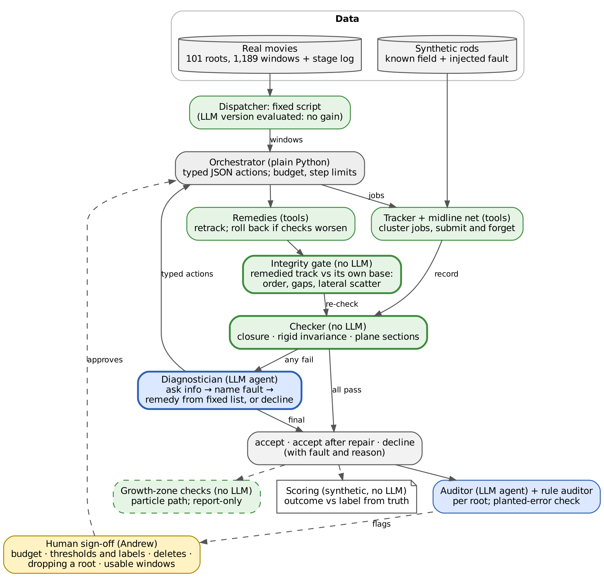

# AM/ME/CE 295 · Lab Report 4

**Name:** Andrew Oldag (solo project) · **Repository:** https://github.com/AndrewOldag/oldag_andrew_me295_project_repo · **Demo slides:** [ME 295 Lab Report 4 - Demo (Oldag)](https://docs.google.com/presentation/d/1YBTxREa9JQ9CtzmFiQlxPXcm-6gvXBzGPmgOAtmBPvg/edit?usp=sharing)

## A1. Problem statement and goal
A growing root is a slender rod whose material generates its own strain: the axial strain-rate field sets elongation, and its difference across the section sets bending. The field is measured by image correlation on time-lapse movies, and the measurement fails silently (stage drift, low texture, a second root, a jittering midline). The goal is a system that checks every measurement against beam kinematics and either repairs it with a remedy from a fixed list or declines to report it, so that 24 h strain-rate maps of 101 drought and recovery roots can be trusted. Research question: does an LLM agent guided by deterministic checks make the repair-or-decline call more reliably than scripted and single-agent baselines?

## B1. Agent design

*Fig. 1. Blue: LLM agents. Green: deterministic tools (dashed: report-only). Grey: plain-Python orchestrator. Yellow: human sign-off. Every agent step is one typed JSON action, validated and executed by the orchestrator. New since Lab report 3: integrity gate on every remedy, rule auditor beside the LLM auditor, growth-zone checks, fixed-script dispatcher (the LLM dispatcher showed no gain).*

## B2. Demonstration
[Slides](https://docs.google.com/presentation/d/1YBTxREa9JQ9CtzmFiQlxPXcm-6gvXBzGPmgOAtmBPvg/edit?usp=sharing) (diagram; integrated run; diagnostician on unseen faults; auditor check; integrity gate; growth-zone check), each with two working examples and one failure case. One command runs the whole loop from cached tracks: `python scripts/run_all.py run --out <dir>`; a fresh root from raw images gave the same outcome as the cached run in 12 of 12 windows (0708_c4, 34 min wall time, 28 of them the cluster job).

## C1. How the system served the research goal
- **Every root measured, every outcome explained.** Integrated run over all 101 include-yes roots, 1,189 two-hour windows, run unattended over three nights; cluster spend $8.25 of the approved $15. Each window ends as accept, accept after repair or decline, with the fault named and the evidence recorded.

| Method (same windows, same tracks) | Accepted | After repair | Declined by rule | Declined by check | Declined by agent / tree | Step limit | Paused |
| :-- | --: | --: | --: | --: | --: | --: | --: |
| Integrated (diagnostician + auditor) | 1,034 | 2 | 58 | – | 85 | 6 | 4 |
| Rule-based remedy tree | 1,034 | 12 | 58 | – | 78 | 0 | 7 |
| Fixed script | 1,034 | 0 | 58 | 93 | – | – | 4 |

- **What decides the result is the checker, not the agent.** 87 % of windows pass the checks unremedied and are reported by every method. On the 93 windows that fail closure, the diagnostician and the tree agree on 74 of the 90 both finished; the tree repairs more (12 vs 2) and the diagnostician declines more. On synthetic rods with known faults (freeze v4) both reach balanced accuracy 0.93; the diagnostician with 0 false accepts, the tree with 2. On faults the tree was not written for (c029b, 20 rods) the tree is better: overall 0.75 vs 0.48, because the agent declines repairable rods (18 unnecessary declines).
- **Speed of the build.** About 29 k lines of Python and 1,248 commits in 6.5 weeks, written by Claude build sessions from specs I approved.

## C2. Where the system broke, the verifiers added, and where my input is mandatory

| Break | Evidence | Verifier added |
| :-- | :-- | :-- |
| A remedy "repaired" a window whose tracked points were scrambled | Registration: closure 22.8 → 14.0 px/h (pass), neighbour gaps 1–166 px | Integrity gate: a remedied track must keep point order, gaps and lateral scatter within $k$ of its own base track; else roll back. Registration rebuilt (direct to frame 0, plausibility bound) |
| The LLM auditor reviews LLM output and had not been checked (LR3 feedback) | 15 errors planted in 30 accepted batches, 3 repeats: LLM 8–9 of 15 caught, all 4 wrong-unit plants missed; rule auditor 15 of 15, more false alarms (55 vs 20–25 of 225) | Both auditors run; the rule auditor covers units and frame counts, the LLM auditor reads the evidence |
| Closure is a sum over the tip path and cannot see where growth sits (LR3 feedback question) | A shifted growth-zone profile passes every check | Particle-path check: integrate $\frac{dX}{dt}=v(X)$ from the measured profile and compare with tracked points. On 130 clean real windows (labelled by me) it catches 90 px (≈ 76 µm) shifts in 78 %, 0 false alarms; smaller shifts pass. Report-only; zone shifts of interest are hundreds of µm |
| A held-out set did not separate methods | Declining everything scored 20 of 24 | Supplement with a selection rule fixed before labelling; all-decline 0.30 |
| Batch 2 stopped at 38 of 84 windows | One held-open link VM → lab server → cluster; drops and a silent 3 h 50 min dead link | Submit-and-forget queue: no step waits on the cluster; compute on cluster nodes only |
| Public repo and report errors | Independent audit (Claude Fable session, read-only, 62 findings): biology values in history, wrong counts in Lab reports 2–3, a gate that passed tracks with lost points | Masked, history rewritten, gate fixed (no committed outcome changed), dated corrections in the earlier reports (`docs/reports/corrections_for_lab_report_4.md`) |

**Decisions that always need my sign-off:** compute budget; any threshold, label, prompt or remedy-list change after a scored run starts; dropping a root or changing its usable windows; accepting a real window only after a geometry-changing remedy (registration, midline swap) in the final dataset; any delete. Run caps (e.g. the LLM call cap, raised 900 → 1,300 mid-run) are resource limits and were delegated, with the change disclosed.

## E1. Last steps before the final report and presentation
- 4-page IEEE paper (Dec 9): claim limited to the measured result above, a negative result for repair skill on unseen faults stated as such; AI Use Declaration appendix.
- Presentation (Dec 2): the same story with the integrated run, the held-out comparison and the verifiers.
- Clean-clone check of the README's install and demo steps.
- Risk: claims about the agent rest on synthetic labels; real windows have no ground truth, so "repaired" means only that the checker passes after a kept remedy.

## AI Use Declaration
| Tool | Used for | How it was checked |
| :-- | :-- | :-- |
| Claude Code (Opus 5.5), build sessions on the VM | Nearly all code, tests, runs, results READMEs | Not read line by line by me; deterministic tests (509), proposals and labels committed before runs, independent audit, my review through the planning account |
| Claude (Opus 5.5), planning account | Specs, design review, merges, this report's draft, Fig. 1, slides | I approved each spec and decision and edited this report |
| Claude Code (Fable 5.2), audit session | Read-only audit of the whole project (62 findings) | Each finding checked against the evidence before a fix; I accepted the fixes |
| `claude-opus-5-5` inside the system | Diagnostician, auditor, single-agent baseline (the system under test) | Labels from tracker-only sweeps; planted-error check; scoring in code |
